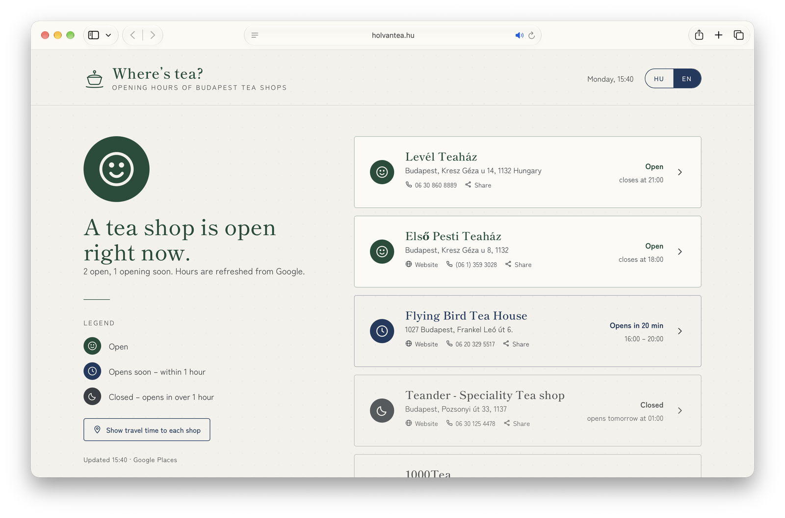
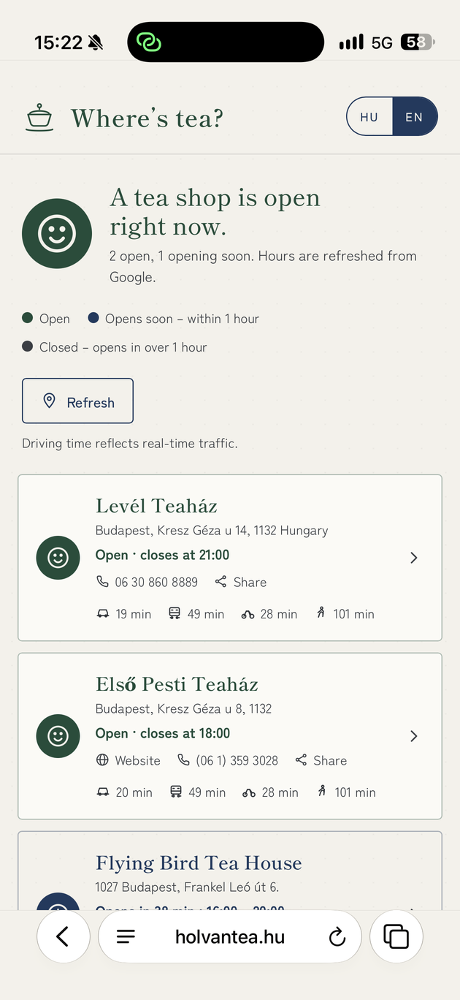

# 🍵 Hol van tea? – Which Budapest tea shop is open right now?

**Live:** [holvantea.hu](https://holvantea.hu)

A small, mobile-first web app that shows which Budapest tea shops are open **right now**, sorted by opening status, with live opening hours from Google, contact details and travel time from the visitor's location.

<p align="center">
  
  &nbsp;
  
</p>

---

## ✨ Features

- **Live opening status:** open (sorted by closing time) · opening within the hour · closed (sorted by next opening)
- **"Closing soon" warning** when an open shop closes within 30 minutes
- **Travel time** from the visitor's location by car (traffic-aware), public transport, bike and on foot
- **Website, phone and share button** on every shop card; tapping a card opens Google Maps
- **Hungarian / English** language switch
- **Installable PWA:** add to home screen, offline UI shell via service worker
- **Works without an API key:** falls back to manually maintained opening hours

## 🏗️ How it works

```
Browser (index.html)            PHP backend (shared hosting)              Google APIs
──────────────────────          ─────────────────────────────            ─────────────────
UI + status logic (JS)  ──►  api.php       ── cached 6h ──────────►  Places API (New)
Budapest-time sorting   ──►  distance.php  ── cached 3 min ───────►  Routes API (matrix)
Auto-refresh 30s / 15m        lib.php  (shared helpers, HTTP client, file cache)
                              shops.txt (flat-file "database")
```

- **The API key never reaches the client.** All Google calls go through a small PHP proxy.
- **File-based caching** keeps Google API usage (and cost) minimal: Place IDs are resolved once, opening hours are cached for 6 hours, and route lookups for 3 minutes per ~10 m location.
- **Abuse & cost protection:** the travel-time endpoint is same-origin only, rate-limited per IP and capped per day/month to stay within Google's free tier, plus a global daily cap on all Google calls.
- **Hosting-friendly:** no framework, no database server, no build step. It runs on plain cPanel shared hosting and falls back to the system temp dir if the cache folder isn't writable (`open_basedir`).
- **Flat-file data:** shops are kept in a human-editable `shops.txt` (`id|name|address|placeId|fallback hours`).

## 🧰 Tech stack

PHP (strict types) · vanilla JavaScript · HTML/CSS · Google Places API (New) · Google Routes API · PWA (manifest + service worker)

## 🚀 Setup

1. Upload the files to your web host (e.g. `public_html/tea/`).
2. Copy `config.example.php` to `config.php` and add your Google API key.
3. Make sure `cache/` is writable by the web server.

The full setup guide (in Hungarian), including enabling the Google APIs, restricting the key and editing the shop list, is in [`docs/TELEPITES.md`](docs/TELEPITES.md).

## 📁 Project structure

| File | Purpose |
|---|---|
| `index.html` | Full UI: HTML + CSS + JS in one file, HU/EN switch |
| `api.php` | Opening hours, website and phone from Google Places, with caching |
| `distance.php` | Travel times from the visitor's location (Google Routes, matrix call) |
| `lib.php` | Shared helpers: shop loader, HTTP client, Place ID lookup, file cache |
| `config.example.php` | Configuration template (copy to `config.php`) |
| `shops.txt` | Flat-file shop list |
| `manifest.json`, `sw.js`, `icons/` | PWA support |

## 🤖 About this project

Designed and built by **László Farkas**, with Claude as an AI pair-programmer for architecture, code and review.
